<p align="center">
  <picture>
    <source media="(prefers-color-scheme: dark)" srcset="docs/images/exedra-wordmark-dark.svg">
    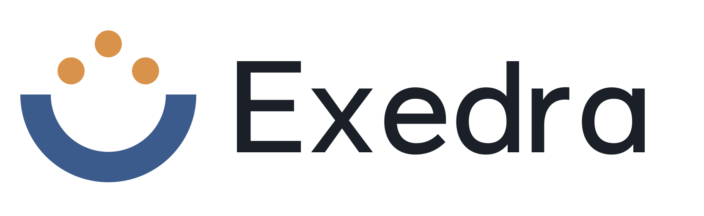
  </picture>
</p>

**A community site in one program: chat, a forum, a wiki and a catalog.**
They share the same members, sign-in, roles, search and admin page. Each
one is a module you switch on or off, so a site can run just the chat,
just the forum, or all four.

Exedra is written in Free Pascal from end to end. The server is a single
native program, and the scripts that run in the browser are Pascal too,
compiled to JavaScript with pas2js. It keeps its data in MariaDB, MySQL,
PostgreSQL or SQLite, your choice.
There are ready-built releases for Linux (x86_64 and 64-bit ARM, so a
Raspberry Pi works) and FreeBSD.

It runs [pascal.chat](https://pascal.chat), an unofficial community for
Pascal developers. The wiki there holds nearly 7,000 pages recovered from
an archive of the official Free Pascal wiki, kept as a large set of real
data to test with. The catalog lists nearly 30,000 projects we gathered
ourselves for the same reason. Some day it may grow into part of a
package manager, or a directory of applications you can install and try
out in a container. For now those are ideas.

| | |
|---|---|
| 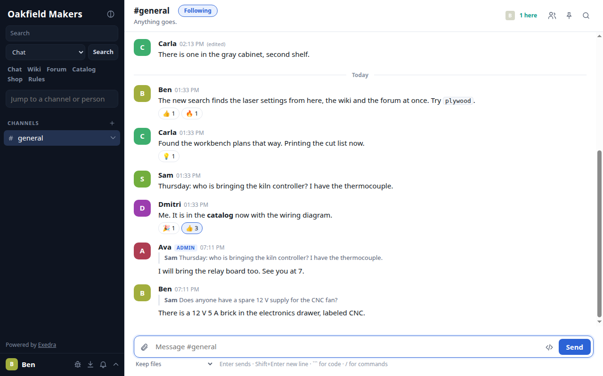 | 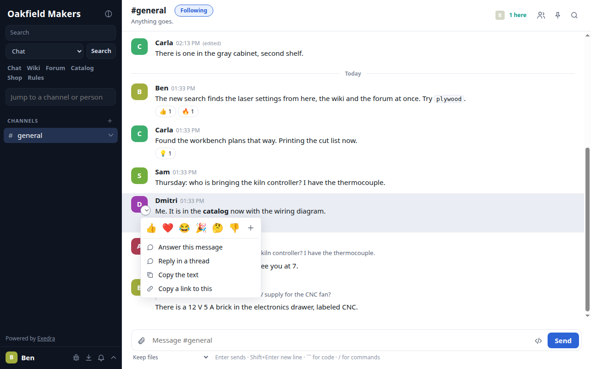 |
| The chat | Every message has a menu |
| 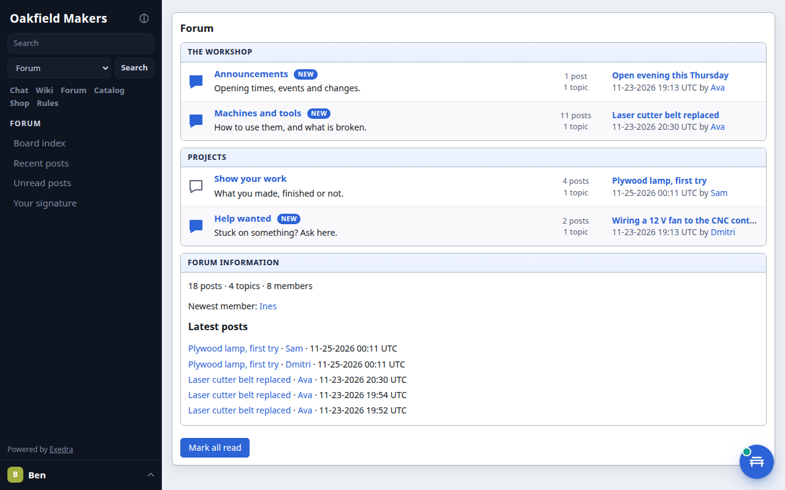 | 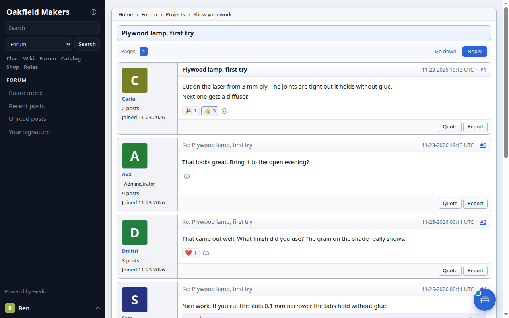 |
| The forum | A topic, with reactions |
| 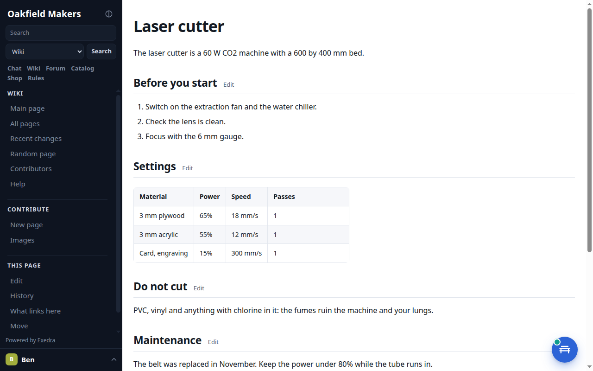 | 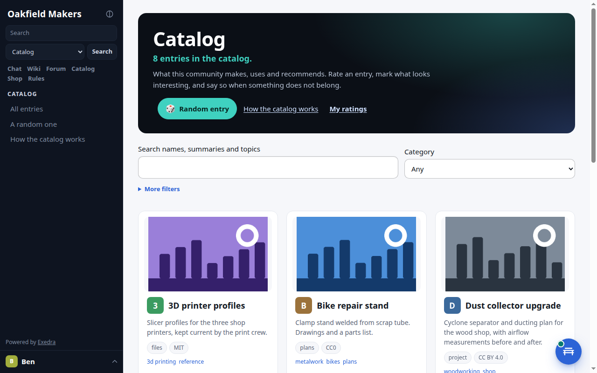 |
| The wiki | The catalog |
| 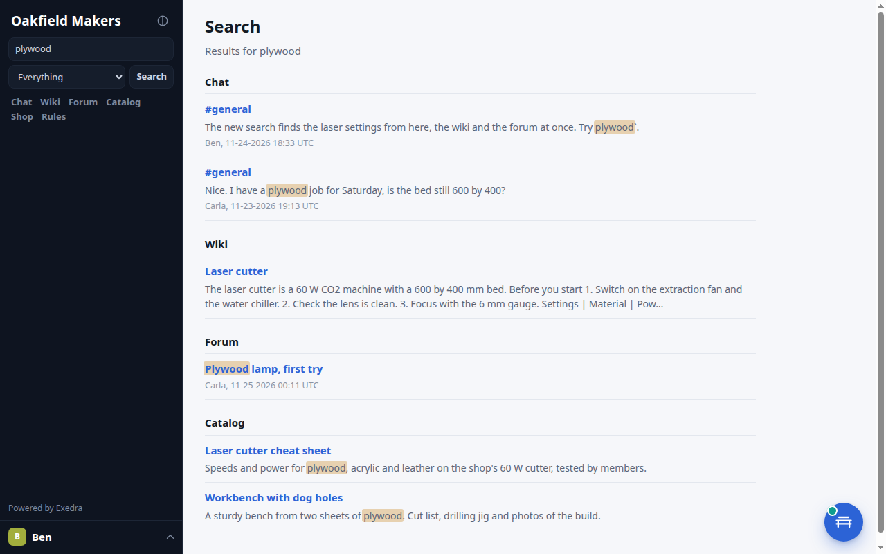 | 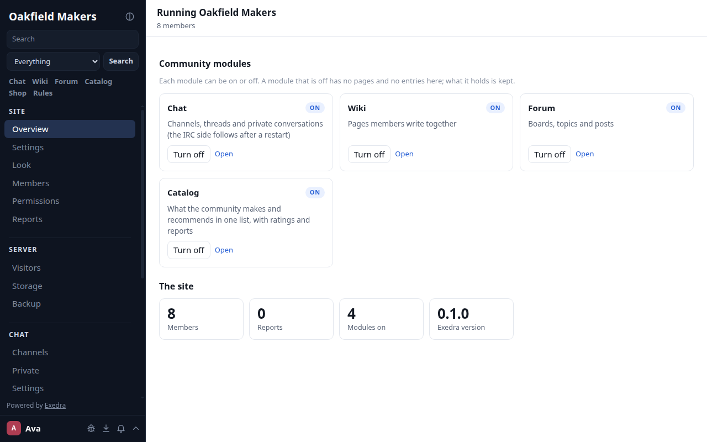 |
| One search for all of it | The admin page |

<p align="center">
  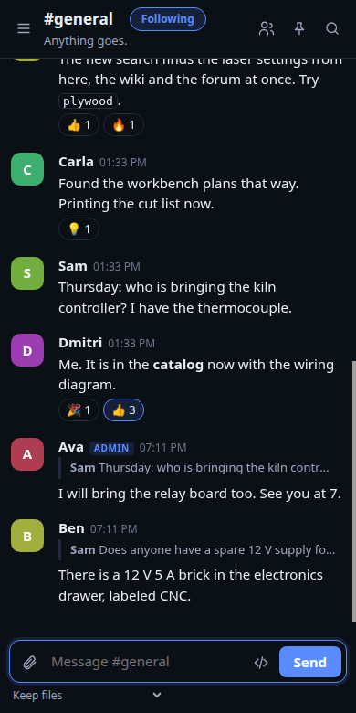
  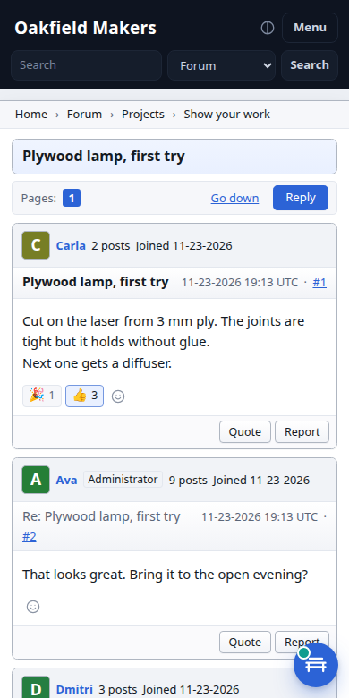
  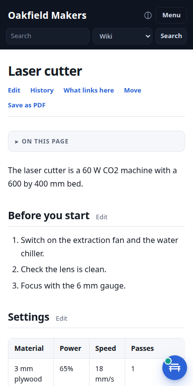
</p>

Every page works on a phone, in light and dark. The pictures show a
made-up community.

## Why one program

Normally a community that wants a chat, a forum and a wiki installs
three different applications. Something like Rocket.Chat, Mattermost or
Zulip for the chat. Discourse or phpBB for the forum. MediaWiki for the
wiki. Each has its own accounts, its own admin pages and its own backups,
and members sign up three times.

Each of those also brings its own stack. Between them you end up
installing things like Node.js, MongoDB, PostgreSQL, Redis, RabbitMQ,
memcached, PHP, Ruby on Rails and Docker, and keeping all of it updated.
Their own documentation gives an idea of the weight:

| | What its docs ask for |
|---|---|
| Rocket.Chat | Node.js and a MongoDB server |
| Mattermost | PostgreSQL, and 2 GB of memory to start |
| Zulip | a machine to itself and at least 2 GB of memory |
| Discourse | Docker, and 1 GB of memory with swap at the very least |
| **Exedra** | **one program. A small site sits at about 40 MB of memory** |

Those are good programs with far more people behind them than this one.
The point is only what it takes to run them. With Exedra it is one
program, one account per member, one admin page, one search across
everything and one backup file.

It is free under a license that asks nothing of you. No paid edition, no
member limit, nothing held back.

## What you get

- **Chat.** Channels, threads, reactions, answers, mentions, files and
  link previews. Private conversations are encrypted end to end, so the
  server cannot read them. That part is young and needs much more
  testing ([SECURITY.md](SECURITY.md) says what to expect of it).
  Notifications on the phone. An IRC side for people who live in HexChat
  or irssi.
- **Forum.** Boards in categories, moderation, reactions, following a
  topic and mail about replies.
- **Wiki.** Markdown pages with revisions, categories, pictures and more
  than one language.
- **Catalog.** A list of what your community makes, uses or recommends,
  with ratings, filters and pictures. You can shape it to your subject
  with a few lines of plain Pascal that add your own fields and filters.
  The catalog of Pascal projects on pascal.chat is built that way.
- **One search** over all four, showing each reader only what they may
  see, with suggestions while you type. It runs on
  [Ferret](https://github.com/TonyStone31/Ferret), a search engine in
  Pascal made for it. Private conversations are never searched.
- **A chat on every page.** A button in the corner of any page opens the
  talk about that page. One line of HTML puts it on another web site's
  pages too.
- **No captchas.** Scrapers, floods, password guessers and spam bots are
  dealt with by measures built in and on from the first start. Real
  people are not bothered. The details stay out of this page on purpose.
- **31 languages.**
- **Modules of your own.** The four modules plug in through the same
  hooks a fifth can use. [docs/MODULES.md](docs/MODULES.md) has a small
  working example.

The full list is [further down](#what-it-does).

## Why Pascal

Free Pascal compiles to native code, and that is most of why Exedra is
small and quick.

- **Nothing else to install.** There is no interpreter, no garbage
  collector and no separate runtime to set up. What a Free Pascal
  program needs while it runs is built into the program itself.
- **One file, only 29 MB.** Everything is linked into a single program:
  the web server, live connections, all four modules, mail, backups and
  the admin page. The whole download is 17 MB.
- **Cryptography and TLS built in, and that is where most of the size
  goes.** About two thirds of those 29 MB are the cryptography and TLS
  code, done in Pascal and built into the program. Without it Exedra
  would be around 10 MB, but it would need the system's OpenSSL, and
  that differs from one system to the next and can be a problem on ARM
  boards and small installs. This way the same program runs the same
  everywhere, linked against the system's C library and nothing else.
  This is about an easy install. It is not a claim that these libraries
  are safer than OpenSSL, which has far more people looking after it. A
  fix in that code reaches you with a new Exedra release, so keep yours
  up to date, and put a public site behind a proxy that does the TLS
  (more on that below).
- **Mostly what ships with Free Pascal.** The web server, the routing
  and the WebSockets are fcl-web. The databases go through fcl-db's
  SQLDB. JSON, Markdown and syntax coloring are FCL packages too. On top
  of that are four Pascal libraries by one author for cryptography and
  TLS, and [Ferret](https://github.com/TonyStone31/Ferret), the
  full-text search engine written for Exedra. A copy of Ferret comes
  with the source in `server/src/ferret`, so there is nothing more to
  fetch for it.
- **Quick to build.** The server is about 47,000 lines of Pascal, and a
  full rebuild takes about five seconds.
- **Plain pages.** The server sends finished HTML and CSS, and the
  scripts only add what a page does. No framework, no bundler, no npm.
- **Easy to read.** A module is a unit, a page is a procedure, a setting
  is one line.

### Pascal in the browser too

The page scripts are written in Object Pascal and compiled to JavaScript
with [pas2js](https://wiki.freepascal.org/pas2js): about 22,000 lines in
53 units, one or a few for each script. They used to be hand-written
JavaScript. Moving them over found a handful of small bugs in pas2js
itself, and the fixes are going back upstream.

- **Small and quick in the browser.** All the page units are compiled
  as one program, so whatever no page uses is left out. A page's scripts
  take about a megabyte and a half of memory in the browser, and a first
  visit downloads about 70 KB of them. Later pages fetch only what they
  have not seen yet.
- **Nothing extra to build or install.** The compiled scripts are in the
  repository and in every release. You need pas2js only to change them.
- **Three small files stay JavaScript on purpose:** the line other sites
  paste to show the chat on their pages, the chat that line brings
  (so those pages need nothing else), and the service worker, which runs
  apart from any page.

### It is not an old CGI script

Exedra is a server program that stays running. It has its own HTTP
server and keeps a live connection to every open page, which is how
messages and reactions show up at once.

There is also a CGI build, for shared hosting where you cannot keep a
program running. The wiki, the forum and the catalog work fine that way.
The chat does not, because CGI cannot hold a live connection, so we do
not recommend it for the chat. If you have a real server or a VPS, use
the normal program.

## Tested at scale

The chat was load tested in October 2026 on an ordinary 6-core machine
with MariaDB, with 1,000,000 members, 2,100,000 messages and 7,000,000
channel follows in the database:

| Request | Median time |
|---|---|
| Checking for new messages | 4 ms |
| Opening a channel of 600,000 messages and scrolling back | 8 to 10 ms |
| Completing an @name out of a million | 1 ms |
| Searching for a rare word | 7 ms |

With 5,000 browser pages open in one channel and a message posted every
second, all 150,000 deliveries arrived, half of them within 215 ms. The
server held those 5,000 connections in 261 MB of memory.

That is one setup, not a promise for every site. Today Exedra runs as
one program on one machine. Running several copies behind a load
balancer is not built yet. The piece that is missing is passing live
updates between copies, and that is where the work would go when a site
needs it.

## Getting started

On Linux a ready-built release installs with one script, no compiler
needed:

```sh
curl -fsSLO https://raw.githubusercontent.com/TonyStone31/exedra/main/install.sh
sudo sh install.sh
```

On FreeBSD the same script installs the FreeBSD release. Run it as root,
with `fetch` in place of `curl -fsSLO`.

It starts on SQLite, so there is no database server to set up. To use
MariaDB, MySQL or PostgreSQL, name it in the config file. A backup made
on one database restores on another, so you can start small and move
later.

[INSTALL.md](INSTALL.md) goes from nothing to a working site.

A few things worth knowing first:

- **Put a proxy in front** for HTTPS: HAProxy, nginx or Caddy. It has
  to pass WebSocket connections through.
  [INSTALL.md, step 6](INSTALL.md#6-put-it-on-the-internet) has a working
  config for each, and for running under a path such as
  `example.com/community`.
- **The first account is an ordinary member.** Sign up, then make
  yourself the admin from a shell:
  `exedra exedra.ini --admin YourName`.
- **Set up mail early.** Without it nobody can get a password link or
  confirm an address by themselves.
- **Back up every night.** `exedra --backup --pictures` from cron writes
  one zip with everything.
- **Update with the same script:** `sudo sh install.sh update`.

### Would you rather not set up a proxy?

The proxy is the hardest step of the install, and I know it. Exedra
could serve HTTPS itself and get its Let's Encrypt certificate from the
admin page, so a small site would need no proxy at all. I have not
built that yet, and I would like to know if people want it.

A proxy is still the better setup for a busy site:

- nginx, HAProxy and Caddy face the whole internet every day. The TLS
  library Exedra uses is much younger.
- Ports 80 and 443 belong to one program. If the server also runs a
  website or another app, a proxy is how they share them.
- The proxy keeps answering while Exedra restarts for an update.
- It stops slow connections, floods and oversized requests before they
  reach the app.
- HTTP/2, HTTP/3, compression and caching come with it.

Building it in makes sense for one small server with one site, run by
someone who has never configured a proxy. A club, a makerspace, a small
shop. For them a working site with good enough HTTPS beats a perfect
setup they never finish.

A middle road is the installer setting up Caddy for you from one option
that names your domain. Caddy gets and renews the certificate itself.

If you want either one, [open an issue](https://github.com/TonyStone31/exedra/issues)
and say which. That decides what gets built first.

## What it does

### Shared by every module

- Members with their own accounts, or sign-in with GitHub, GitLab,
  Google, Microsoft or Codeberg.
- In the browser and the desktop program the password never leaves the
  member's device. A login secret is derived from it there, and the
  server only stores a hash of that. An IRC client is the exception: it
  sends the password to the server, as IRC does.
- A member changes their own password and email address, and can close
  their account. What they wrote stays, under their name or as "Former
  member".
- Roles and permissions set from a table of check boxes. The chat, the
  wiki and the forum each have a moderator and an admin role of their
  own.
- One admin page: members, permissions, settings, look, reports,
  backups, storage and a visitors report.
- One search box on every page.
- Backup and restore of the database and files as one zip.

### Chat

- Channels, threads, pins, mentions, files and link previews.
- A menu on every message, opened from its corner or by a right-click.
- Reactions with the names of who gave each. The admin edits the list of
  emoji.
- A message can answer another, which is quoted above it, and its author
  is told.
- Private conversations encrypted end to end (ECDH P-256, AES-GCM), with
  read receipts the admin or each member can turn off. Each conversation
  shows a safety code the two members can compare, and says when the
  other member's key has changed. [SECURITY.md](SECURITY.md) says what
  this protects against and what it does not, and that it still needs
  much more testing.
- Files in a private channel or conversation open only for those who may
  read the message.
- Beams: a file sent straight from one browser to another.
- Code blocks colored for Pascal and about 30 other languages.
- Slash commands, channel moderators, mute and ban.
- Benches: a channel for a page, opened from the corner button
  ([INSTALL.md, step 5](INSTALL.md#the-corner-chat-and-benches)).
- An IRC side, so HexChat, WeeChat or irssi can join the same channels.
- Web Push notifications, and mail about missed messages.
- An installable web app for phones.

### Wiki

- Pages in Markdown with an editor, a preview and section editing.
- Revisions, categories, a link index, moving and deleting pages.
- Pictures and file pages.
- Pages in more than one language.

### Forum

- Boards in categories, topics and posts in Markdown, with the wiki's
  editor.
- Moderation: pin, lock, move and hide. Members report a post.
- Reactions under a post, with the names of who gave each. A reaction
  never bumps a topic.
- Following a topic: a notice and one mail about replies until you have
  read it, and every mail has a link that stops it.
- Search, read marks, files in posts and a signature for each member.
- A view count that counts people, not reloads or crawlers.

### Catalog

- Entries with a page of their own, categories, search and filters.
- Members rate an entry, mark it Interesting, and report one that does
  not belong.
- Entries are added on the admin page, with a picture, or sent in bulk
  as JSON.
- A site's own unit adds fields and page parts to an entry.

The catalog is the newest module and is off on a new site.

## Exedra Desktop

A Lazarus program for Linux, Windows and macOS that talks to any Exedra
server. Its source is in `desktop/` and
[desktop/README.md](desktop/README.md) says how to build it. It is
younger than the server, so take it as a preview for now.

## For developers

- **The API.** Everything the chat's page does goes through a JSON API,
  so an app or a bot can do the same: [docs/API.md](docs/API.md).
- **The source.** The server's units are in `server/src`: `core` and a
  folder for each module. The page scripts' units are in
  `server/src/pages`. [docs/CODE-MAP.md](docs/CODE-MAP.md) is a map of it.
- **Your own module.** [docs/MODULES.md](docs/MODULES.md).

## Requirements

- **To run it:** Linux on x86_64 or 64-bit ARM, or FreeBSD on x86_64.
- **A database:** MariaDB, MySQL 8, PostgreSQL or SQLite.
- **A proxy in front for TLS:** HAProxy, nginx or Caddy.
- **To build it yourself:** Free Pascal 3.3.1 and Lazarus, with
  [CryptoLib4Pascal](https://github.com/Xor-el/CryptoLib4Pascal),
  [HashLib4Pascal](https://github.com/Xor-el/HashLib4Pascal),
  [SimpleBaseLib4Pascal](https://github.com/Xor-el/SimpleBaseLib4Pascal)
  and [TlsLib4Pascal](https://github.com/Xor-el/TlsLib4Pascal). All four
  are MIT licensed.
  The search engine, [Ferret](https://github.com/TonyStone31/Ferret)
  (0BSD), is already in the source as `server/src/ferret`, a copy of
  its own repository kept as it is.
- **To change the page scripts:** pas2js 3.3.1 as well (it comes with
  Free Pascal's main branch) and its RTL units.
  `server/src/pages/build.sh` builds them. The built files are in the
  repository, so building the server does not need it.
- **About the compiler:** Exedra is built with the development version
  of Free Pascal (3.3.1, "trunk"). It uses the Markdown, code coloring
  and WebSocket units that the released 3.2 does not have yet. Trunk
  changes every day, so a build with a newer trunk than ours can hit a
  problem we have not seen. The release packages need no compiler. Once
  Free Pascal ships a release with those units, Exedra will build with it.

## The name

An exedra (say EK-seh-drah) was a part of Greek and Roman public
buildings: an open recess, often a half circle, with a bench running
along the wall. It was built for sitting down and talking. Teachers
held their classes in them and people met there to argue and trade
news. That is what this program is for.

The mark is that bench seen from above, with three people on it.

## License

[0BSD](LICENSE). Use it for anything.

Two things in `server/src/ferret` are other people's work: the word
stemmers come from the [Snowball](https://snowballstem.org/) project
(BSD 3-clause), and the letter tables are made from Unicode data. Their
notices are in that folder and in every release.

## Security

Found a security problem? Please report it privately, as
[SECURITY.md](SECURITY.md) describes.
